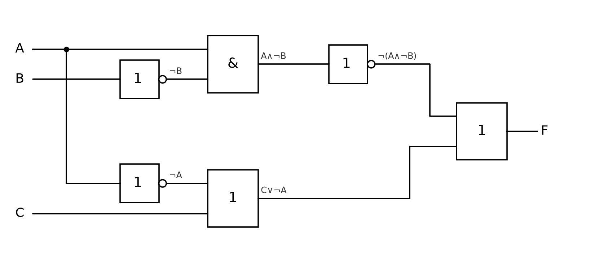
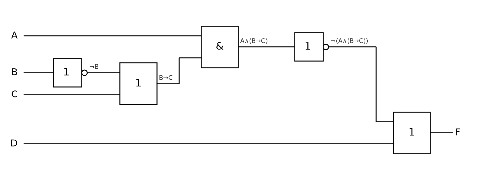

# ДЗ: Накопители и память, логические схемы

Абдуллаев Билолиддин Низомидинович, группа 9/2-РПО-25/3

## Файлы

- [память-HDD-SSD.docx](память-HDD-SSD.docx): таблица HDD и SSD, определения терминов DDR, DIMM, ранг, CL, тайминги, двухканальный режим.
- [логические-схемы.docx](логические-схемы.docx): переход от схем к формулам и от формул к схемам.

## Из схемы в формулу

Схема 1: `F = (¬A ∧ B) ∨ (A ∧ ¬B) = A ⊕ B`

Схема 2, входы сверху вниз A, B, C, D:

`F = (¬A ∨ B) ∨ (B ∧ ¬C) ∨ ((¬A ∨ ¬B) ∧ (¬C ∨ D))`

После упрощения: `F = ¬A ∨ B ∨ ¬C ∨ D`

## Из формулы в схему

`(A ∧ ¬B) → (C ∨ ¬A)`, упрощённо `¬A ∨ B ∨ C`

`¬(A ∧ (B → C)) ∨ D`, упрощённо `¬A ∨ (B ∧ ¬C) ∨ D`

