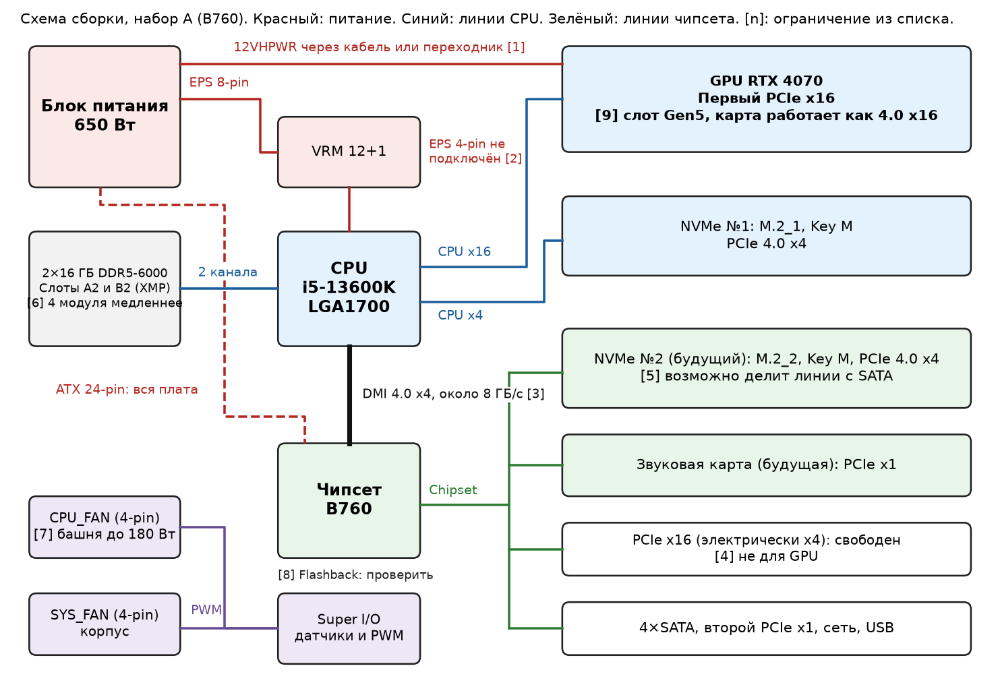

# ДЗ: Сборка и диагностика ПК без BIOS и дополнительных программ

Абдуллаев Билолиддин Низомидинович, группа 9/2-РПО-25/3

Работа с ответами на все 7 заданий: [сборка-и-диагностика-ПК.docx](сборка-и-диагностика-ПК.docx)

## Итог

Выбран **набор A**: i5-13600K, B760, 2×16 ГБ DDR5-6000, RTX 4070.

- По форм-фактору подходят все три набора, корпус поддерживает ATX и mATX.
- Набор B не позволяет поставить второй NVMe: второй M.2 имеет ключ E.
- По мощности подходят все наборы: 431, 392 и 230 Вт при блоке 650 Вт. Разъём питания видеокарты нужно уточнить.
- Набор C слаб для 1440p и стриминга и почти не оставляет запаса.

## Схема сборки

