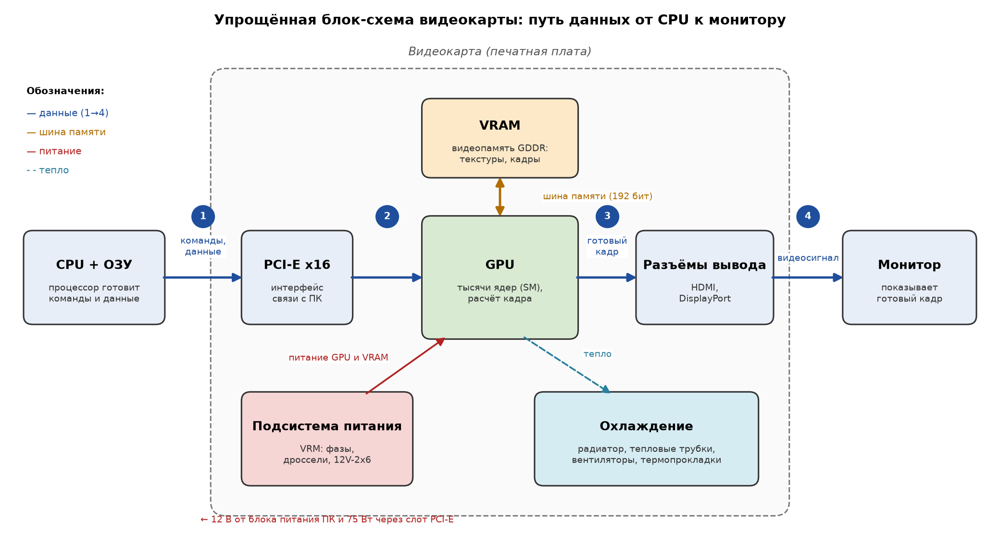

# ДЗ: Устройство видеокарты (GPU)

Абдуллаев Билолиддин Низомидинович, группа 9/2-РПО-25/3

Работа с ответами на все 4 части: [видеокарта-GPU.docx](видеокарта-GPU.docx)

## Кратко

- **Теория:** 5 блоков видеокарты, GPU и CPU, VRAM и ОЗУ, SIMT и варпы, охлаждение и питание.
- **Схема:** путь данных CPU → PCI-E → GPU ⇄ VRAM → разъёмы вывода → монитор, плюс питание и охлаждение.
- **Практика:** NVIDIA GeForce RTX 5070 (Blackwell): 12 ГБ GDDR7, шина 192 бит, 6144 ядра CUDA, TGP 250 Вт.
  По частоте из nvidia-smi (14 001 МГц) пропускная способность выходит 336 ГБ/с, а по эффективной частоте
  (28 Гбит/с) — 672 ГБ/с, как в паспорте.
- **Вывод:** GPU нужны для ИИ, потому что нейросети — это миллиарды одинаковых независимых операций с матрицами.

## Схема видеокарты

