# Домашнее задание 08: настройка BIOS/UEFI (10 задач)

Абдуллаев Билолиддин Низомидинович, группа 9/2-РПО-25/3

Симулятор: https://download.lenovo.com/bsco/index.html (BSC V4.3.0), графический режим (Graphics Interface Mode).

| Устройство | Верхнее меню | Для каких задач |
|---|---|---|
| **ThinkCentre M70s Gen 4 (12DM, 12DN, 12DS, 12DT)** — настольный ПК | Main · Devices · Advanced · Power · Security · Startup · Exit | 1–10 |
| **ThinkPad T14 Gen 4 (21HD, 21HE)** — ноутбук | Main · Config · Date/Time · Security · Startup · Restart | 9 (Reset system to Factory Defaults) |

Ноутбук понадобился только для задачи 9: у ThinkCentre M70s Gen 4 нет пункта Reset system to Factory Defaults.

Внизу экрана подсказки клавиш: **F9** — Setup Defaults, **F10** — Save and Exit, **Esc** — выход.
Все снимки лежат в папке [img](img/).

---

## Задача 1. Аппаратная виртуализация (Intel VT-x)

**Точный путь:** **Advanced → CPU Setup → Intel(R) Virtualization Technology**.
**Состояние:** **Enabled** (включено по умолчанию, включать не пришлось).

Рядом в CPU Setup:
- **VT-d Feature** — Enabled: виртуализация ввода-вывода, даёт виртуальной машине прямой доступ к устройству
  (проброс видеокарты или сетевой карты);
- **TxT** (Trusted Execution Technology) — Disabled.

На ноутбуках ThinkPad этот пункт лежит в **Security → Virtualization** (на старых моделях — **Config → CPU**).
На процессорах AMD он называется **AMD-V** или **SVM Mode**.

**Зачем нужна.** VT-x — набор инструкций процессора, на которых работает гипервизор. С ним гостевая ОС
выполняется прямо на процессоре, а не эмулируется программно. Без VT-x не запускаются Hyper-V и WSL 2,
а VMware и VirtualBox выдают ошибку «VT-x is disabled in the BIOS» или не запускают 64-битные гостевые
системы. На VT-x также работают функции защиты Windows: VBS, Memory Integrity, Credential Guard.

## Задача 2. TPM и BitLocker

**Путь:** **Security → TCG Feature Setup → Security Chip 2.0**.
**Состояние:** **Enabled**, TCG Security Device State = **Discrete TPM 2.0**.

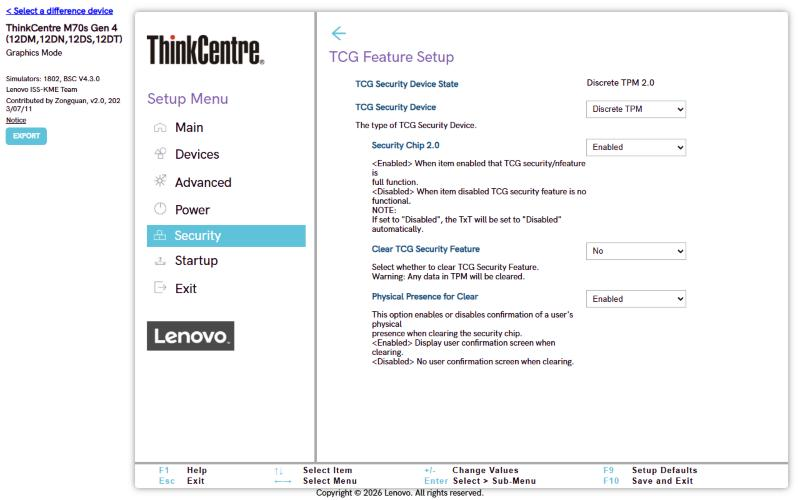

В том же разделе:
- **TCG Security Device** — тип чипа (Discrete TPM);
- **Clear TCG Security Feature** — очистка TPM, предупреждение: все данные в TPM будут удалены;
- **Physical Presence for Clear** — Enabled: при очистке чипа нужно подтверждение человеком.

Подсказка к Security Chip 2.0: если поставить Disabled, то **TxT** тоже автоматически отключится.

**Нужна ли перезагрузка.** Да. Изменение записывается только после **F10 (Save and Exit)** и вступает
в силу со следующей загрузки: Windows узнаёт о TPM при старте. В симуляторе переключатель меняется сразу.

**Связь с BitLocker.** TPM хранит ключ шифрования диска и отдаёт его, только если загрузка не изменилась
(прошивка, загрузчик, Secure Boot). Поэтому Windows расшифровывает диск сама, без пароля.
- Если **отключить TPM**, BitLocker не получит ключ: при загрузке появится экран **BitLocker Recovery**
  с запросом **48-значного ключа восстановления**. Без этого ключа данные не прочитать.
- Включить новое шифрование без TPM можно только с паролем или USB-ключом через групповую политику.
- **Clear TCG Security Feature** удаляет ключи навсегда.
- Перед изменением TPM, Secure Boot или обновлением BIOS BitLocker приостанавливают:
  `manage-bde -protectors -disable C:`.

## Задача 3. Поведение после потери питания (After Power Loss)

**Путь:** **Power → After Power Loss**. Варианты: **Power Off | Power On | Last State**.
**По умолчанию стоит Last State.**

Выбрал **Power On**, затем вернул **Last State**:

| Режим | Что происходит, когда питание вернулось |
|---|---|
| **Power Off** | Компьютер остаётся выключенным, включают кнопкой |
| **Power On** | Компьютер включается всегда, даже если до сбоя был выключен |
| **Last State** | Возвращается в прежнее состояние: работал — включится, был выключен — останется выключенным |

Подсказка BIOS: Power On выбирают, если компьютер включают через сетевой фильтр с выключателем.

**Сервер в удалённой стойке:** нужен **Power On**. Сервер должен работать всегда, а приехать и нажать кнопку
некому. **Last State** подходит, если сервер иногда выключают специально и после сбоя он должен остаться
выключенным. **Power Off** для удалённой машины не годится.

В этом же меню есть раздел **Automatic Power On** — функции автоматического включения (например,
Wake on LAN — включение по сети), тоже нужные для удалённого администрирования.

## Задача 4. Отключение Secure Boot

**Путь:** **Security → Secure Boot → Secure Boot**. Исходно **Enabled**.

Переключил в **Disabled**, затем вернул **Enabled**:

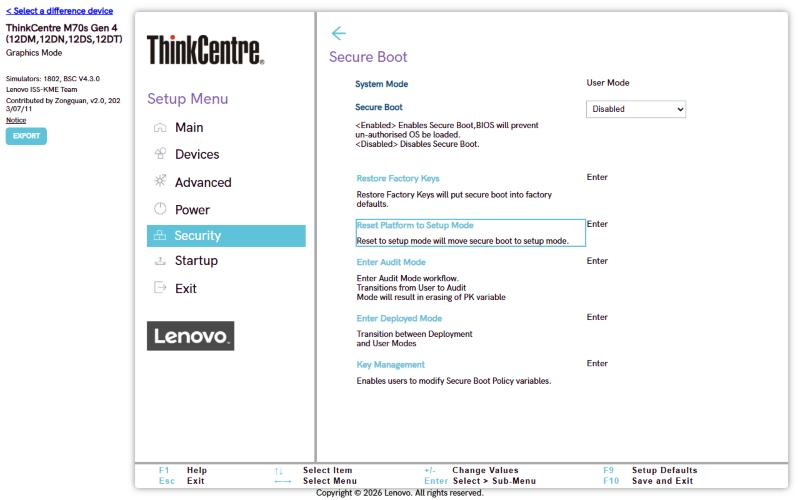

**Предупреждение.** При отключении Secure Boot симулятор окна с предупреждением не показывает. Подсказка
к пункту: *Enabled — BIOS не даст загрузить неавторизованную ОС; Disabled — Secure Boot выключен.*

**Где статус.** В этом же разделе строка **System Mode = User Mode**:
- **User Mode** — ключ платформы (PK) установлен, проверка подписей работает;
- **Setup Mode** — ключа PK нет, проверка не работает (в этот режим переводит **Reset Platform to Setup Mode**);
- **Audit Mode** и **Deployed Mode** — служебные режимы (**Enter Audit Mode**, **Enter Deployed Mode**).

Ещё здесь **Restore Factory Keys** (вернуть заводские ключи) и **Key Management** (свои ключи).

**Когда отключают Secure Boot:**
1. Загрузка с флешки или диска с неподписанным загрузчиком: старые LiveCD, утилиты клонирования,
   MemTest, DOS-утилиты для прошивки.
2. Установка дистрибутивов Linux без подписанного загрузчика shim или Linux с неподписанным модулем
   ядра (драйвер NVIDIA, VirtualBox).
3. Установка старых ОС (Windows 7 и ниже), которые не поддерживают Secure Boot.

## Задача 5. Fast Boot

**Путь:** **Startup → Fast Boot**. Исходно **Enabled**.

Отключил (**Disabled**), затем включил обратно:

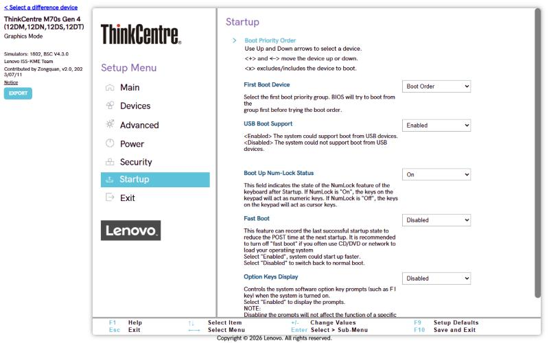

**Что изменилось.** В самом симуляторе ничего: Boot Priority Order, First Boot Device и USB Boot Support
остались на месте, экрана включения с F12 в симуляторе нет. Разница видна на реальной машине при включении:
- **Fast Boot Enabled.** BIOS запоминает последнюю удачную загрузку и пропускает инициализацию части
  устройств. Заставка проходит быстро, окно для нажатия F1 или F12 очень короткое, USB-накопители
  и сеть могут не опрашиваться.
- **Fast Boot Disabled.** Полный POST: опрашиваются все USB-устройства, клавиатура готова сразу,
  F12 (Boot Menu) успевает сработать, флешка появляется в списке.

Подсказка BIOS к пункту: *рекомендуется выключить Fast Boot, если ОС часто загружают с CD/DVD или по сети.*

**Почему не видна флешка.** При Fast Boot BIOS повторяет прошлую удачную загрузку и не инициализирует
USB-контроллеры и накопители до старта ОС. Флешка, вставленная после последней загрузки, не опрашивается:
её нет ни в F12, ни в порядке загрузки. В Windows ещё есть «быстрый запуск» (гибернация ядра), при котором
полного POST тоже нет. Решение — выключить Fast Boot, перезагрузиться и нажать F12.

## Задача 6. Пароль на включение (Power-On Password)

**Путь:** **Security → Set Power-On Password** (на ThinkPad — **Security → Password → Power-On Password**).
Исходно все пароли **Not Installed**.

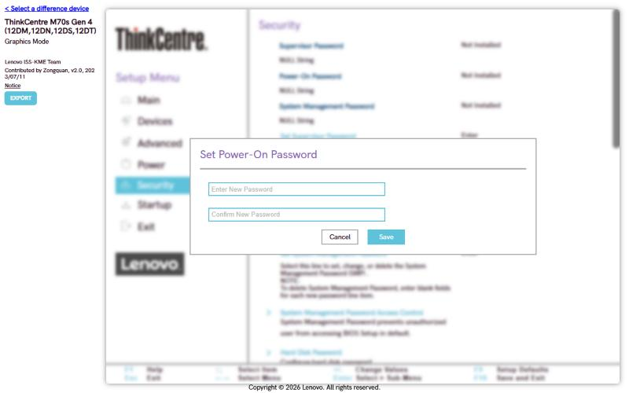

1. Ввёл `Boot1234` в **Enter New Password** и **Confirm New Password**, нажал **Save**.
   При повторном открытии окна в обоих полях стоит `Boot1234` — пароль сохранён:

   

2. В меню Security у пункта **Set Power-On Password** статус **Enabled**. Строка «Power-On Password»
   вверху в симуляторе так и остаётся «Not Installed» — симулятор её не обновляет.

   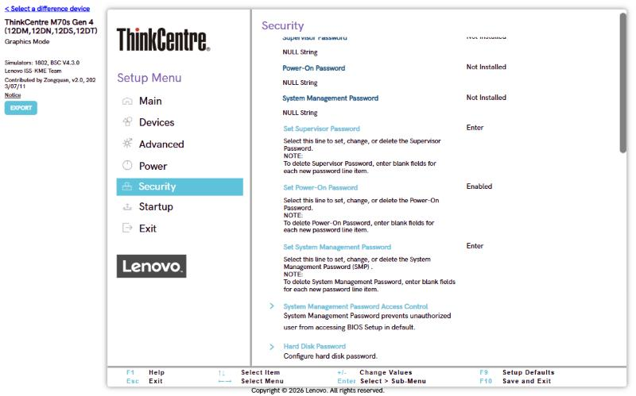

3. **Повторный вход.** Проверить запрос пароля нельзя: симулятор не спрашивает пароль при входе, а после
   **Save & Exit** возвращается к выбору устройства и сбрасывает все настройки. На реальном ПК пароль
   спрашивается сразу после включения, ещё до загрузки ОС.
4. **Сброс.** По подсказке BIOS пароль удаляют так: вводят текущий пароль, а поля нового оставляют пустыми.
   Симулятор пустые поля не принимает — пишет *«Password must has at least 1 character»*, поэтому
   сбросить пароль в симуляторе не удалось:

   

| | Power-On Password (POP) | Supervisor Password (SVP) |
|---|---|---|
| Когда спрашивается | При каждом включении, до загрузки ОС | При входе в BIOS Setup и при изменении защищённых настроек |
| Что защищает | Сам компьютер: без пароля он не загрузится | Настройки BIOS: порядок загрузки, Secure Boot, TPM, пароли |
| Кто знает | Пользователь | Только IT-администратор |
| Если забыли | Снимает администратор паролем SVP | На ThinkPad не сбрасывается батарейкой, нужна замена платы |

**Когда что нужно.** POP — чтобы украденным или оставленным компьютером не воспользовался посторонний.
SVP — чтобы сотрудник не мог сам отключить Secure Boot, поставить загрузку с флешки и обойти защиту
компании. В организации обычно ставят оба, а SVP знает только IT-отдел. На ThinkCentre есть ещё
**System Management Password** — по подсказке BIOS он защищает вход в BIOS Setup от посторонних.

## Задача 7. Режим контроллера накопителей (SATA Controller Mode)

**Путь:** **Devices → Storage Setup → Configure Storage as**. Варианты: **AHCI | RAID**, по умолчанию **AHCI**.

Переключил **AHCI → RAID**, затем обратно:

Отдельного окна при смене режима нет, но в подсказке к пункту написано: для AHCI и RAID нужен свой драйвер,
и смена режима может помешать загрузке системы — в зависимости от того, как был установлен образ диска.
На ноутбуках ThinkPad пункт называется **Config → Storage → Controller Mode** (AHCI mode | RST mode).

| Режим | Что это |
|---|---|
| **AHCI** | Стандартный режим SATA. Драйвер есть в любой Windows и Linux |
| **RAID / Intel RST** | Диски работают через контроллер Intel: RAID-массивы, кэширование. Нужен драйвер Intel RST |

**Почему Windows перестаёт загружаться.** При установке Windows включает в загрузку только драйвер того
контроллера, который был выбран в BIOS. Если потом переключить AHCI → RAID (или наоборот), загрузчик
не находит драйвер нового контроллера и не видит системный диск: синий экран **INACCESSIBLE_BOOT_DEVICE**.
По той же причине в режиме RAID/RST установщик Windows не видит диск, пока не загрузишь драйвер Intel RST.
Режим выбирают **до** установки ОС. Если менять после, сначала загружают Windows в безопасном режиме
(`bcdedit /set {current} safeboot minimal`), меняют режим в BIOS и потом убирают безопасный режим.

## Задача 8. Журнал событий BIOS (Event Log)

**Путь:** **Main → BIOS Event Log**. Внутри два пункта: **BIOS Event** и **Clear BIOS Event Log**.

**BIOS Event** — список типов событий. Вместо реальных записей в симуляторе стоит «XX»:

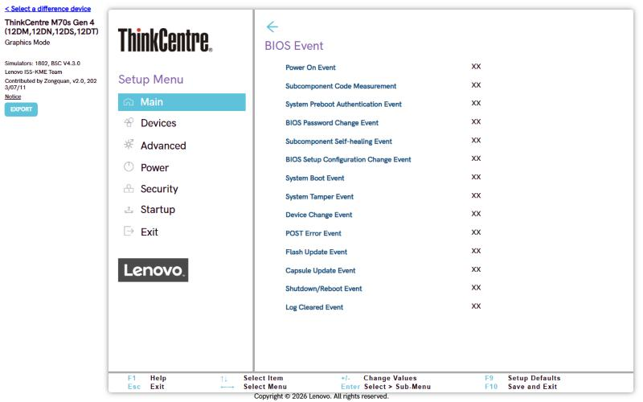

Какие события фиксируются:
- **Power On Event** — включения;
- **System Boot Event** и **Shutdown/Reboot Event** — загрузки, выключения, перезагрузки;
- **POST Error Event** — ошибки самотестирования POST (память, вентилятор, клавиатура);
- **BIOS Setup Configuration Change Event** — изменения настроек BIOS;
- **BIOS Password Change Event** — смена паролей;
- **System Preboot Authentication Event** — ввод пароля до загрузки, в том числе неудачные попытки;
- **Device Change Event** — изменение состава устройств;
- **System Tamper Event** — вскрытие корпуса;
- **Flash Update Event** и **Capsule Update Event** — обновления BIOS;
- **Subcomponent Code Measurement** и **Subcomponent Self-healing Event** — проверка и восстановление кода прошивки;
- **Log Cleared Event** — очистка журнала.

**Очистка:** **Clear BIOS Event Log** → окно «Clear BIOS Event Log» → **Yes**.

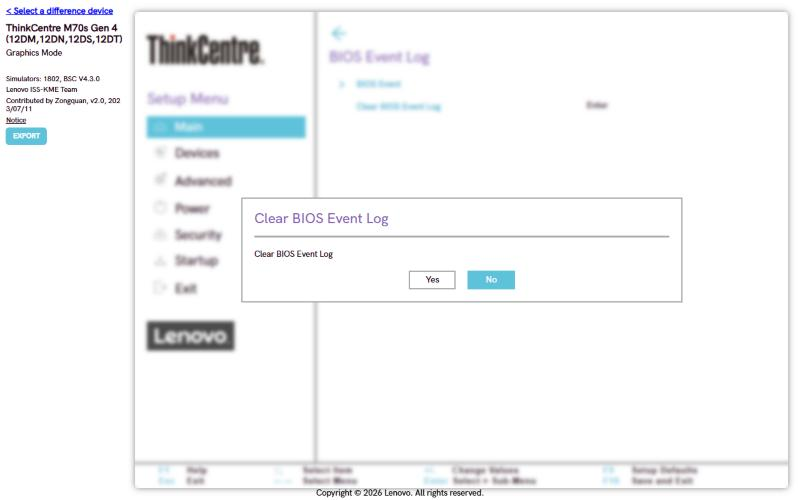

**Зачем очищать перед передачей устройства:**
1. Журнал хранит историю прошлого владельца: смены паролей, ошибки, вскрытия корпуса. Новому пользователю
   она не нужна.
2. После ремонта или передачи нужен чистый журнал, чтобы новые ошибки POST не путались со старыми,
   уже исправленными.

## Задача 9. Load Factory Defaults и Reset System to Factory Defaults

**Load Factory Defaults.** На ThinkCentre — **Exit → Load Factory Defaults** (на ThinkPad — **Restart**),
клавиша **F9**.

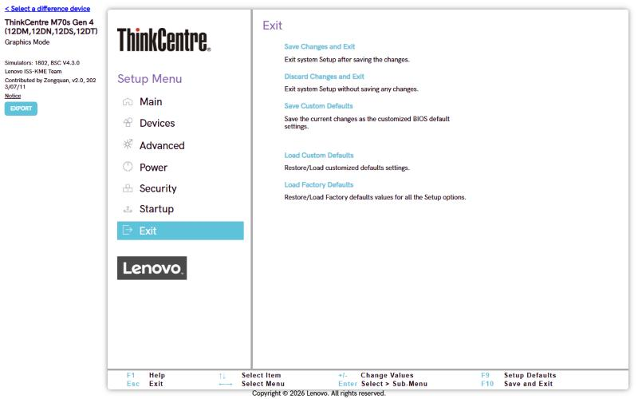

Окно *«Load the BIOS factory default configuration now?»* → **Yes**. Настройки BIOS вернулись к заводским:

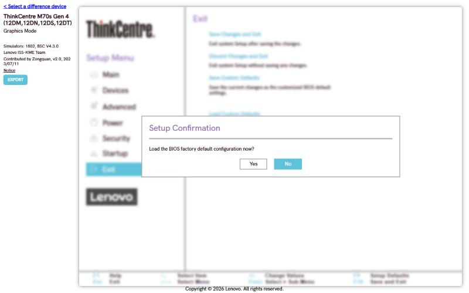

**Reset system to Factory Defaults.** На ThinkCentre M70s Gen 4 этого пункта нет, поэтому открыл
ThinkPad T14 Gen 4: **Security → Reset system to Factory Defaults**.

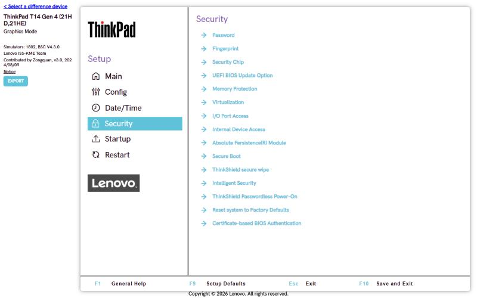

Открыл пункт и прочитал предупреждение, **сброс не выполнял** — нажал **No**. Смысл предупреждения:
система перезагрузится, **навсегда удалит все сохранённые данные** и вернёт заводские настройки;
настройки **Absolute Persistence Module Permanent Disabled** и **Intel AMT Control Permanent Disabled**
не сбрасываются; процесс может занять несколько минут, экран может погаснуть, прерывать его нельзя.

Перед полным сбросом нужно снять пароли (Supervisor, Power-On, пароли NVMe), иначе BIOS не даст его выполнить.

| | Load Factory Defaults | Reset System to Factory Defaults |
|---|---|---|
| Что сбрасывает | Только настройки BIOS: порядок загрузки, Secure Boot, порты | Всё устройство: настройки, пароли, ключи Secure Boot и TPM, **данные на накопителях** |
| Данные на диске | Сохраняются | **Стираются безвозвратно** |
| Пароли | Не сбрасываются | Сбрасываются (их нужно сначала ввести) |
| Отмена | Можно выйти без сохранения | Нельзя |
| Когда использовать | Что-то настроили неправильно, ПК не грузится после изменений в BIOS | Списание, продажа, передача компьютера другому человеку или в другую организацию |

## Задача 10. Подготовка ПК нового сотрудника

| № | Действие | Путь | Значение |
|---|---|---|---|
| 1 | Виртуализация | **Advanced → CPU Setup → Intel(R) Virtualization Technology** | Enabled |
| 2 | TPM | **Security → TCG Feature Setup → Security Chip 2.0** | Enabled |
| 3 | Power-On Password | **Security → Set Power-On Password** | `Boot1234`, Enabled |
| 4 | Fast Boot | **Startup → Fast Boot** | Disabled |
| 5 | После потери питания | **Power → After Power Loss** | Power On |
| 6 | Сохранить и выйти | **Exit → Save Changes and Exit** (F10) → **Yes** | — |

Виртуализация и TPM включены по умолчанию (снимки к задачам 1 и 2), пароль `Boot1234` установлен (задача 6).

After Power Loss = **Power On**:

Fast Boot = **Disabled**:

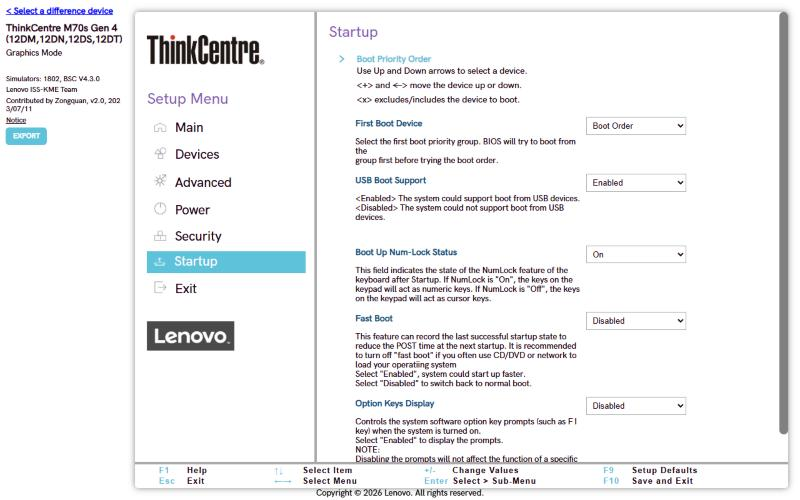

Сохранение: окно *«Save configuration and reset?»* → **Yes**:

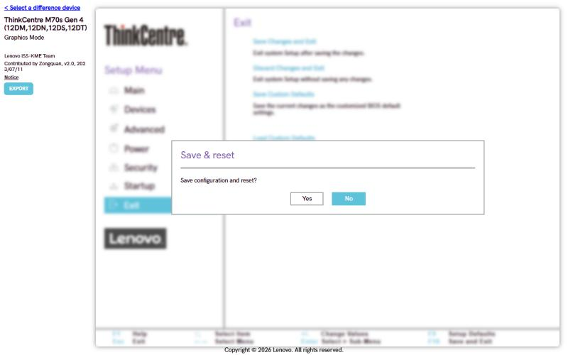

**Проверка после повторного входа.** В симуляторе её выполнить нельзя: после **Save & Exit** он
возвращается к выбору устройства, а при новом входе все значения снова заводские (After Power Loss =
Last State, Fast Boot = Enabled). Поэтому каждая настройка снята до сохранения. На реальном ПК настройки
хранятся в энергонезависимой памяти и остаются после перезагрузки.

**Возврат.** Fast Boot снова Enabled и After Power Loss снова Last State — симулятор вернул их сам при
повторном входе. Пароль снять не удалось: пустой пароль симулятор не сохраняет (см. задачу 6).

**Почему так.** VT-x нужен для Hyper-V, WSL 2 и виртуальных машин; TPM — для BitLocker; POP защищает
от посторонних; без Fast Boot сотрудник сможет загрузиться с флешки через F12; Power On включит рабочую
станцию после сбоя электричества, чтобы к ней можно было подключиться удалённо. Для настоящего рабочего ПК
ещё ставят **Supervisor Password**, чтобы сотрудник не мог отменить эти настройки сам.

## Вывод

На устройствах Lenovo одни и те же группы настроек, но пути разные. У настольного ThinkCentre меню
Main · Devices · Advanced · Power · Security · Startup · Exit: процессор — в Advanced, питание — в Power,
накопители — в Devices. У ноутбука ThinkPad меню Main · Config · Date/Time · Security · Startup · Restart,
а виртуализация и TPM лежат в Security.

Отличия симулятора от реального BIOS:
- изменения применяются сразу, а не после перезагрузки;
- после Save & Exit все настройки сбрасываются на заводские, поэтому проверить их после повторного входа нельзя;
- пароль при входе не запрашивается, пустой пароль сохранить нельзя, поэтому пароль не снять;
- строка статуса Power-On Password не обновляется («Not Installed» при установленном пароле);
- в журнале событий вместо записей стоит «XX»;
- при отключении Secure Boot и смене режима накопителей окна с предупреждением нет.
