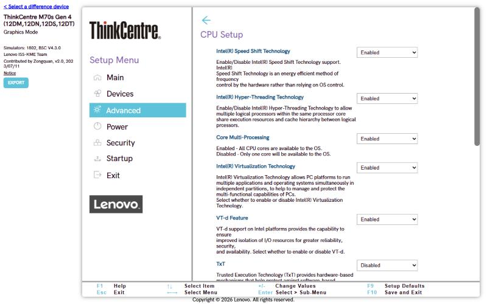
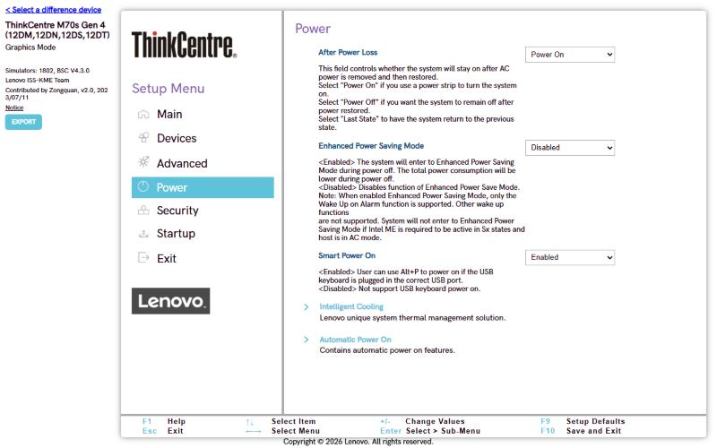
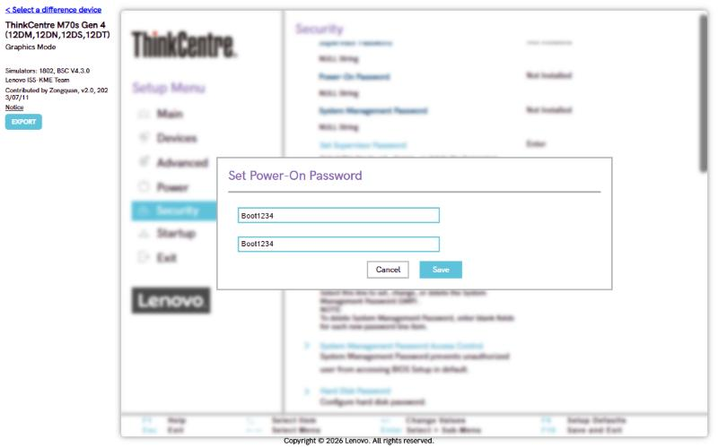
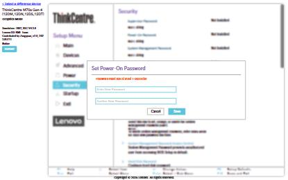
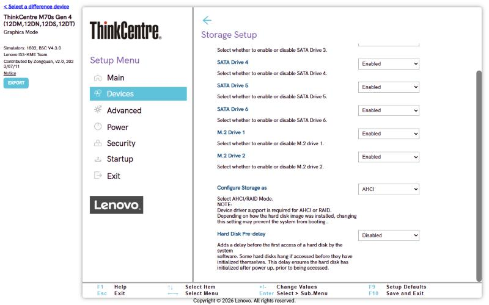
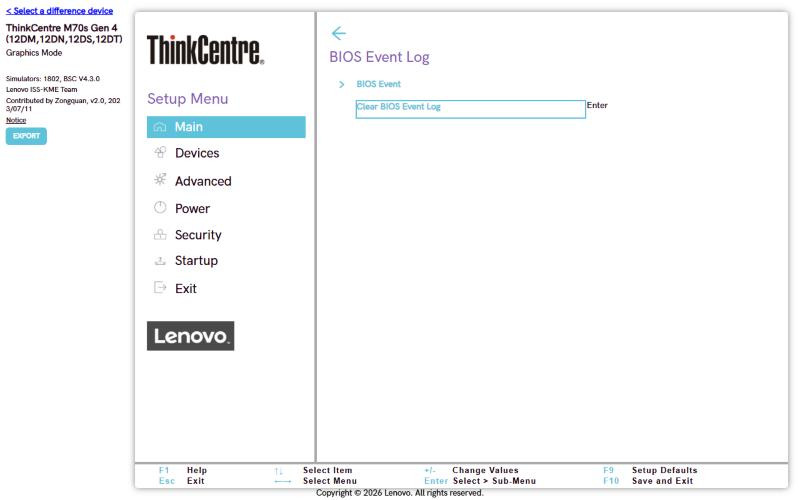
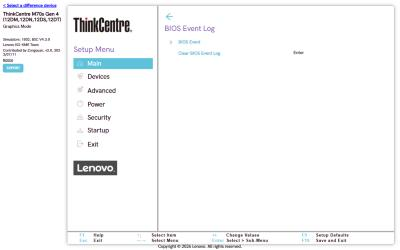
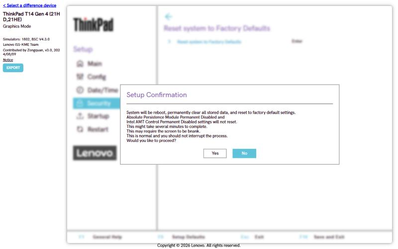

# Домашнее задание 08: настройка BIOS/UEFI (10 задач)

Абдуллаев Билолиддин Низомидинович, группа 9/2-РПО-25/3

Симулятор: https://download.lenovo.com/bsco/index.html (BSC V4.3.0), графический режим.

Использованы ноутбуки и настольные ПК, потому что часть пунктов есть только на настольных ПК.
Скриншоты подтверждения сделаны на M70s Gen 4 и T14 Gen 4:

| Устройство | Верхнее меню | Для каких задач |
|---|---|---|
| **ThinkPad T14s Gen 5 (21LS, 21LT)** — ноутбук | Main · Config · Date/Time · Security · Startup · Restart | 1, 2, 4, 6, 9 |
| **ThinkCentre M70q Gen 5 (12TD…12TG)** — настольный ПК | Main · Devices · Advanced · Power · Security · Startup · Exit | 1, 2, 3, 4, 5, 7, 8, 9 |
| **ThinkCentre M70s Gen 4 (12DM…12DT)** — настольный ПК | Main · Devices · Advanced · Power · Security · Startup · Exit | скриншоты к задачам 1–8, 10 |
| **ThinkPad T14 Gen 4 (21HD, 21HE)** — ноутбук | Main · Config · Date/Time · Security · Startup · Restart | скриншоты к задаче 9 |

В обоих BIOS: **F9** — Setup Defaults, **F10** — Save and Exit, **Esc** — выход.

---

## Задача 1. Аппаратная виртуализация (Intel VT-x)

| Устройство | Точный путь | Состояние |
|---|---|---|
| ThinkCentre M70q Gen 5 | **Advanced → CPU Setup → Intel(R) Virtualization Technology** | Enabled |
| ThinkPad T14s Gen 5 | **Security → Virtualization → Intel(R) Virtualization Technology** | On |

Рядом лежит **VT-d Feature** (Intel VT-d) — виртуализация ввода-вывода: она даёт виртуальной машине
прямой доступ к устройству (проброс видеокарты или сетевой карты).

Включать ничего не пришлось, по умолчанию уже включено. На T14s Gen 5 переключатель вообще серый:
пока включена **Kernel DMA Protection**, BIOS сам держит VT-x и VT-d включёнными. При попытке включить
Kernel DMA Protection появляется окно: *«Intel(R) Virtualization Technology, Intel(R) VT-d Feature are
automatically enabled»*. Чтобы выключить VT-x на этом ноутбуке, сначала нужно выключить Kernel DMA Protection.

У Lenovo путь зависит от линейки: на ноутбуках ThinkPad виртуализация лежит в **Security → Virtualization**
(на старых моделях в **Config → CPU**), на ThinkCentre — в **Advanced → CPU Setup**. На процессорах AMD
пункт называется **AMD-V** или **SVM Mode**.

**Зачем нужна.** VT-x — набор инструкций процессора, на которых работает гипервизор. С ним гостевая ОС
выполняется прямо на процессоре, а не эмулируется программно. Без VT-x Hyper-V и WSL 2 не запускаются,
а VMware и VirtualBox выдают ошибку «VT-x is disabled in the BIOS» или не запускают 64-битные гостевые системы.
Ещё на нём работают функции защиты Windows: VBS, Memory Integrity, Credential Guard.

## Задача 2. TPM и BitLocker

| Устройство | Точный путь | Состояние |
|---|---|---|
| ThinkPad T14s Gen 5 | **Security → Security Chip → Security Chip** | On, тип **TPM 2.0** |
| ThinkCentre M70q Gen 5 | **Security → TCG Feature Setup → Security Chip 2.0** | Enabled |

TPM уже включён. На T14s подсказка к пункту: *On — чип работает; Off — чип скрыт и не работает.*
Пункт **Clear Security Chip** («Clear encryption keys?») становится доступен только при выключенном чипе.
На ThinkCentre есть пункт **Clear TCG Security Feature**, а **Physical Presence for Clear** требует
подтверждения человеком при очистке.

**Нужна ли перезагрузка.** Да. Изменение пишется только после **F10 (Save and Exit)** и вступает в силу
со следующей загрузки: Windows узнаёт о TPM при старте. В симуляторе переключатель меняется сразу.

**Связь с BitLocker.** TPM хранит ключ шифрования диска и отдаёт его, только если загрузка не изменилась
(прошивка, загрузчик, Secure Boot). Поэтому Windows расшифровывает диск сама, без ввода пароля.
- Если **отключить TPM**, BitLocker не получит ключ: при загрузке появится синий экран
  **BitLocker Recovery** с запросом **48-значного ключа восстановления**. Без этого ключа данные не прочитать.
- Новое шифрование без TPM включить нельзя: остаётся только вариант с паролем или USB-ключом через групповую политику.
- **Clear Security Chip** удаляет ключи навсегда. Данные, зашифрованные этими ключами, без ключа восстановления пропадут.
- Перед изменением TPM, Secure Boot или обновлением BIOS BitLocker приостанавливают: `manage-bde -protectors -disable C:`.

## Задача 3. Поведение после потери питания (After Power Loss)

На ноутбуке T14s Gen 5 такого пункта нет: при пропадании сети ноутбук продолжает работать от батареи.
Пункт есть на ThinkCentre.

Путь: **Power → After Power Loss**. Варианты: **Power Off | Power On | Last State**.

Порядок действий: выбрал **Power On**, затем вернул **Last State**.
**По умолчанию стоит Last State.**

| Режим | Что происходит, когда питание вернулось |
|---|---|
| **Power Off** | Компьютер остаётся выключенным, включают кнопкой |
| **Power On** | Компьютер включается всегда, даже если до сбоя был выключен |
| **Last State** | Компьютер возвращается в то состояние, в котором был: работал — включится, был выключен — останется выключенным |

**Сервер в удалённой стойке:** нужен **Power On**. Сервер должен работать всегда, а приехать
и нажать кнопку некому. **Last State** тоже подходит, если сервер иногда выключают специально
и после сбоя он должен остаться выключенным. **Power Off** для удалённой машины не годится.

Рядом есть **Automatic Power On → Wake on LAN**: включение по сети, тоже нужно для удалённого администрирования.

## Задача 4. Отключение Secure Boot

| Устройство | Точный путь | Статус |
|---|---|---|
| ThinkPad T14s Gen 5 | **Security → Secure Boot → Secure Boot** | On; **Secure Boot Mode = User Mode**, **Secure Boot Key State = Standard Mode** |
| ThinkCentre M70q Gen 5 | **Security → Secure Boot → Secure Boot** | Enabled; **System Mode = User Mode** |

Переключил в **Disabled (Off)**, затем вернул **Enabled (On)**.

**Предупреждение.** При простом отключении Secure Boot симулятор окна не показывает. Предупреждения
появляются у пунктов работы с ключами:
- **Reset to Setup Mode**: *«Platform Key will be deleted»*;
- **Clear All Secure Boot Keys**: *«Clear all Secure Boot Keys?»*;
- **Restore Factory Keys**: возвращает заводские ключи.

**Где статус.** На T14s — **Main → UEFI Secure Boot (On/Off)** и в самом разделе Secure Boot:
**Secure Boot Mode** (User Mode — ключи установлены, проверка работает; Setup Mode — ключа платформы
PK нет, проверка не работает) и **Secure Boot Key State** (Standard Mode — заводские ключи Microsoft
и Lenovo, Custom Mode — свои ключи).

**Когда отключают Secure Boot:**
1. Загрузка с флешки или диска с неподписанным загрузчиком: старые LiveCD, утилиты клонирования, MemTest, DOS-утилиты прошивки.
2. Установка дистрибутивов Linux без подписанного shim или Linux с собственным модулем ядра (драйвер NVIDIA, VirtualBox), который не подписан.
3. Установка старых ОС (Windows 7 и ниже), не поддерживающих Secure Boot.

На T14s есть промежуточный вариант: **Allow Microsoft 3rd Party UEFI CA = On**. Тогда загружаются
подписанные Microsoft сторонние загрузчики, например shim у Ubuntu и Fedora, и Secure Boot
выключать не нужно.

## Задача 5. Fast Boot

На T14s Gen 5 пункта **Fast Boot** нет: вместо него **Startup → Boot Mode = Quick | Diagnostics**
(Quick — быстрая загрузка без подробного теста). Пункт Fast Boot есть на ThinkCentre.

Путь: **Startup → Fast Boot**. Исходно **Enabled**. Отключил (**Disabled**), затем включил обратно.

**Что изменилось.** Меню разделов BIOS в симуляторе не изменилось: Boot Menu (F12) и порядок
загрузки остались на месте. Изменение видно на реальной машине при включении:
- **Fast Boot Enabled.** BIOS запоминает последнюю удачную загрузку и пропускает инициализацию
  части устройств. Заставка проходит быстро, окно для нажатия F1 или F12 очень короткое, USB-накопители
  и сеть могут не опрашиваться.
- **Fast Boot Disabled.** Полный POST: опрашиваются все USB-устройства, клавиатура готова сразу,
  F12 (Boot Menu) успевает сработать, флешка появляется в списке.

Подсказка BIOS к пункту: *рекомендуется выключить Fast Boot, если ОС часто загружают с CD/DVD или по сети.*

**Почему не видна флешка.** При Fast Boot BIOS берёт загрузку из прошлой удачной конфигурации
и не инициализирует USB-контроллеры и накопители до старта ОС. Флешка, вставленная после последней
загрузки, просто не опрашивается: её нет ни в F12, ни в порядке загрузки. В Windows есть ещё
и «быстрый запуск» (гибернация ядра), при котором компьютер не проходит полный POST. Решение —
выключить Fast Boot, перезагрузиться и нажать F12.

## Задача 6. Пароль на включение (Power-On Password)

Устройства — T14s Gen 5 и ThinkCentre M70s Gen 4. На ThinkCentre M70q Gen 5 ввод пароля
в симуляторе не поддерживается («Simulator not support!!!»), а на M70s Gen 4 работает:
путь **Security → Set Power-On Password** (снимки в конце файла).

Путь на ThinkPad: **Security → Password → Power-On Password**. Исходно **Disabled**.

1. Ввёл `Boot1234` в **Enter New Password** и **Confirm New Password**, нажал Save → статус **Enabled**.
2. **F10 → Yes** (Save configuration changes and exit now?).
3. Повторный вход: статус Power-On Password — **Enabled**, пароль сохранился. Отдельного окна запроса
   пароля при входе симулятор не показывает: на реальном ThinkPad пароль спрашивается сразу после
   включения, ещё до логотипа ОС.
4. Сброс: на реальной машине вводят текущий пароль `Boot1234`, а новый оставляют пустым → Disabled.
   В симуляторе так сделать нельзя: Save с пустыми полями не срабатывает (как и в практике 1),
   на M70s Gen 4 появляется сообщение «Password must has at least 1 character». Поэтому сброс
   пароля в симуляторе выполнить не удалось, пароль остался установленным. Load Factory Defaults
   для этого не подходит: на реальном ThinkPad он пароли не сбрасывает (см. задачу 9).

| | Power-On Password (POP) | Supervisor Password (SVP) |
|---|---|---|
| Когда спрашивается | При каждом включении, до загрузки ОС | При входе в BIOS Setup и при попытке изменить защищённые настройки |
| Что защищает | Сам компьютер: без пароля он не загрузится | Настройки BIOS: порядок загрузки, Secure Boot, TPM, пароли |
| Кто знает | Пользователь | Только IT-администратор |
| Если забыли | Снимает администратор паролем SVP | На ThinkPad не сбрасывается батарейкой, нужна замена платы |

**Когда что нужно.** POP — чтобы украденным или оставленным ноутбуком не воспользовался посторонний.
SVP — чтобы сотрудник не мог сам отключить Secure Boot, поставить загрузку с флешки и обойти
защиту компании. В организации обычно ставят оба, а SVP знает только IT-отдел.

## Задача 7. Режим контроллера накопителей (SATA Controller Mode)

На T14s Gen 5 раздела Storage нет (один NVMe-диск, режим не переключается). Пункт есть на ThinkCentre.

Путь: **Devices → Storage Setup → Configure Storage as**. Варианты: **AHCI | RAID** (по умолчанию **AHCI**).
На ThinkPad T490 (практика 1) пункт называется **Config → Storage → Controller Mode** с вариантами
**AHCI mode | RST mode**.

Переключил AHCI → RAID, затем обратно. На ThinkCentre окно не появилось. На T490 при смене
выводится предупреждение: *«The existing data stored on the drives may be damaged when changing Controller Mode»*.

| Режим | Что это |
|---|---|
| **AHCI** | Стандартный режим SATA. Драйвер есть в любой Windows и Linux |
| **RAID / Intel RST (VMD)** | Диски работают через контроллер Intel: RAID-массивы, кэширование на Optane. Нужен драйвер Intel RST |

**Почему Windows перестаёт загружаться.** Windows при установке включает в загрузку только драйвер
того контроллера, который был в BIOS. Если после установки переключить AHCI → RAID (или наоборот),
загрузчик не находит драйвер для нового контроллера и не видит системный диск: синий экран
**INACCESSIBLE_BOOT_DEVICE**. Отсюда и обратная проблема: при RAID/RST установщик Windows не видит диск,
пока не загрузишь драйвер Intel RST. Режим выбирают **до** установки ОС. Если менять после, сначала
загружают Windows в безопасном режиме (`bcdedit /set {current} safeboot minimal`), меняют режим в BIOS,
а потом убирают безопасный режим.

## Задача 8. Журнал событий BIOS (Event Log)

| Устройство | Путь | Результат |
|---|---|---|
| ThinkPad T14s Gen 5 | **Main → BIOS Event log** | «(Simulator not support)», не открывается |
| ThinkCentre M70q Gen 5 | **Main → BIOS Event Log → BIOS Event** | Список типов событий |

На ThinkCentre журнал есть, но вместо реальных записей стоит «XX». Типы событий:

- **Power On Event** — включения;
- **System Boot Event** — загрузки системы;
- **POST Error Event** — ошибки самотестирования POST (память, вентилятор, клавиатура);
- **BIOS Setup Configuration Change Event** — изменения настроек BIOS;
- **BIOS Password Change Event** — смена паролей;
- **System Preboot Authentication Event** — ввод пароля до загрузки, в том числе неудачные попытки;
- **Device Change Event** — изменение состава устройств (память, диски);
- **System Tamper Event** — вскрытие корпуса;
- **Subcomponent Code Measurement** — измерения кода для проверки целостности.

Очистка: **Main → BIOS Event Log → Clear BIOS Event Log** → подтверждение «Clear BIOS Event Log» → журнал пуст.

**Зачем очищать перед передачей устройства:**
1. Журнал хранит историю прошлого владельца: смены паролей, ошибки, вскрытия корпуса. Новому пользователю она не нужна.
2. После ремонта или передачи нужен чистый журнал, чтобы новые ошибки POST не путались со старыми,
   уже исправленными, и диагностика была точной.

## Задача 9. Load Factory Defaults и Reset System to Factory Defaults

**Restart → Load Factory Defaults** (на ThinkCentre — **Exit → Load Factory Defaults**, клавиша **F9**).
Окно: *«Load the BIOS factory default configuration now?»* → **Yes**. Настройки BIOS вернулись
к заводским, после F10 применяются.

**Security → Reset system to Factory Defaults** — открыл, прочитал, **не выполнял**. Текст предупреждения:
*«System will be reboot, permanently clear all stored data, and reset to factory default settings.
Absolute Persistence Module Permanent Disabled and Intel AMT Control Permanent Disabled settings will not reset.
This might take several minutes to complete.»*

Перед сбросом нужно снять пароли (Supervisor, Power-On, пароли NVMe), иначе BIOS не даст его выполнить.
Состояние **Absolute Persistence** (Security → Absolute Persistence(R) Module, сейчас Not Activated)
сброс не меняет: если модуль навсегда отключён, он таким и останется.

| | Load Factory Defaults | Reset System to Factory Defaults |
|---|---|---|
| Что сбрасывает | Только настройки BIOS: порядок загрузки, Secure Boot, порты | Всё устройство: настройки, пароли, ключи Secure Boot и TPM, **данные на накопителях** |
| Данные на диске | Сохраняются | **Стираются безвозвратно** |
| Пароли | На реальном ThinkPad не сбрасываются | Сбрасываются (их нужно сначала ввести) |
| Отмена | Можно выйти без сохранения | Нельзя |
| Когда использовать | Что-то настроили неправильно, ПК не грузится после изменений в BIOS | Списание, продажа, передача ноутбука другому человеку или в другую организацию |

## Задача 10. Подготовка ПК нового сотрудника

Шаги и пути. На каком устройстве что проверено, указано в скобках.

| № | Действие | Путь | Значение |
|---|---|---|---|
| 1 | Виртуализация | ThinkPad: **Security → Virtualization → Intel(R) Virtualization Technology**; ThinkCentre: **Advanced → CPU Setup** | On / Enabled |
| 2 | TPM | ThinkPad: **Security → Security Chip**; ThinkCentre: **Security → TCG Feature Setup → Security Chip 2.0** | On / Enabled |
| 3 | Power-On Password | ThinkPad: **Security → Password → Power-On Password**; ThinkCentre M70s Gen 4: **Security → Set Power-On Password** | `Boot1234`, Enabled |
| 4 | Fast Boot | **Startup → Fast Boot** (ThinkCentre) | Disabled |
| 5 | После потери питания | **Power → After Power Loss** (ThinkCentre) | Power On |
| 6 | Сохранить и выйти | **F10 → Yes** | — |

**Проверка после повторного входа.** Перед сохранением все пять значений были выставлены:
виртуализация Enabled, TPM Enabled, Power-On Password Enabled, Fast Boot Disabled,
After Power Loss = Power On (снимки в конце файла). Проверить их после повторного входа в симуляторе
нельзя: после **Save & Exit** он возвращается к выбору устройства, а при новом входе все значения
снова заводские (After Power Loss = Last State, Fast Boot = Enabled). На реальном ПК настройки
сохраняются в NVRAM и остаются после перезагрузки.

**Возврат:** Fast Boot снова Enabled, After Power Loss снова Last State — симулятор вернул их сам
при повторном входе. Пароль в симуляторе снять не удалось: пустой пароль он не сохраняет (см. задачу 6).

Почему так: VT-x нужен для Hyper-V, WSL 2 и виртуальных машин; TPM — для BitLocker; POP защищает
от посторонних; без Fast Boot сотрудник сможет загрузиться с флешки через F12; Power On включит
рабочую станцию после сбоя электричества, чтобы к ней можно было подключиться удалённо.
Для настоящего рабочего ПК ещё ставят **Supervisor Password**, чтобы сотрудник не мог отменить эти настройки сам.

## Вывод

На всех устройствах Lenovo одни и те же группы настроек, но пути разные. У ноутбука ThinkPad
меню Main · Config · Security · Startup · Restart, а виртуализация и TPM лежат в Security.
У настольного ThinkCentre меню Main · Devices · Advanced · Power · Security · Startup · Exit,
процессор — в Advanced, питание — в Power. Пунктов After Power Loss и Fast Boot на ноутбуке нет.

Отличия симулятора от реального BIOS: изменения применяются сразу, а не после перезагрузки;
пароль не запрашивается при входе; нельзя сохранить пустой пароль, поэтому пароль не снять;
журнал событий на ThinkPad не поддерживается, а на ThinkCentre вместо записей стоит «XX»;
на ThinkCentre M70q Gen 5 не поддерживается ввод паролей (на M70s Gen 4 работает);
на M70s Gen 4 после Save & Exit все настройки сбрасываются на заводские.

---

## Скриншоты подтверждения

Снимки сделаны 27.11.2026 в том же симуляторе на **ThinkCentre M70s Gen 4 (12DM, 12DN, 12DS, 12DT)**,
а для полного сброса (задача 9) на **ThinkPad T14 Gen 4 (21HD, 21HE)**. Пути на этих моделях
совпадают с путями ThinkCentre и ThinkPad, описанными выше. Все файлы лежат в папке [img](img/).

Две особенности M70s Gen 4: здесь ввод пароля работает, а после **Save & Exit** симулятор
возвращается к выбору устройства и сбрасывает все значения. Поэтому в задаче 10 каждая настройка
снята до сохранения.

### Задача 1. Advanced → CPU Setup → Intel(R) Virtualization Technology = Enabled

### Задача 2. Security → TCG Feature Setup → Security Chip 2.0 = Enabled (Discrete TPM 2.0)

### Задача 3. Power → After Power Loss

По умолчанию Last State:

Выбран Power On (потом возвращён Last State):

### Задача 4. Security → Secure Boot

Исходно Enabled, System Mode = User Mode:

Переключено в Disabled (окна с предупреждением нет), затем возвращено Enabled:

### Задача 5. Startup → Fast Boot

Исходно Enabled:

Отключено, затем включено обратно:

### Задача 6. Security → Set Power-On Password

Окно установки пароля:

Введён `Boot1234` в оба поля:

После сохранения пункт Set Power-On Password = Enabled:

Сброс пустыми полями симулятор не принимает («Password must has at least 1 character»):

### Задача 7. Devices → Storage Setup → Configure Storage as

AHCI (по умолчанию), под пунктом предупреждение, что смена режима может помешать загрузке:

Переключено на RAID, затем обратно на AHCI:

### Задача 8. Main → BIOS Event Log

Типы событий:

Очистка журнала:

### Задача 9. Load Factory Defaults и Reset system to Factory Defaults

Меню Exit на ThinkCentre:

Load Factory Defaults, подтверждено Yes:

ThinkPad T14 Gen 4, Security → Reset system to Factory Defaults:

Предупреждение о полном сбросе, нажато **No** (сброс не выполнялся):

### Задача 10. Подготовка ПК нового сотрудника

Виртуализация и TPM включены (см. снимки к задачам 1 и 2), пароль `Boot1234` установлен (задача 6).

After Power Loss = Power On:

Fast Boot = Disabled:

Save & Exit:

