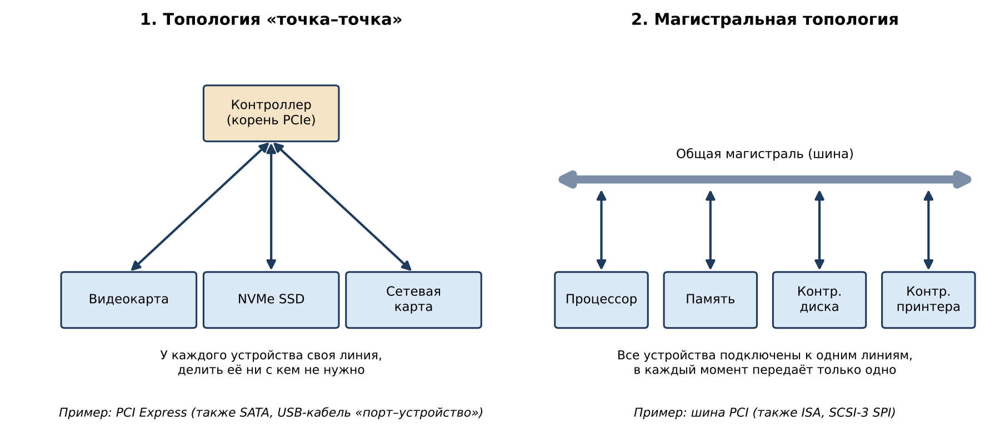

# ДЗ: Системы ввода-вывода и интерфейсы

Абдуллаев Билолиддин Низомидинович, группа 9/2-РПО-25/3

Задание: [Dz/i_o.md](https://github.com/yaroslavrychikin-crypto/architectura-apparatnix-sredstv/blob/main/Dz/i_o.md).
Материал: презентация «Ввод вывод и интерфейсы» (тема 1.1), рис. 1.2 и таблица 4 (слайд 19).

Работа с ответами на все три части: [ввод-вывод-и-интерфейсы.docx](ввод-вывод-и-интерфейсы.docx)

## Кратко

- **А1:** в интерфейсе стандартизируют линии, сигналы, протоколы и конструктив; магистраль — все линии,
  шина — группа линий одного назначения; соединения «каждый с каждым», радиальное и магистральное;
  симплекс, полудуплекс и дуплекс.
- **А2:** электронных модулей; FSB; BSB, быстрее; универсальные и специализированные.
- **Б1:** USB (последовательный), ATA (параллельный), SCSI-3 SPI (до 160 Мбайт/с). Для внешнего диска
  из них лучше SCSI-3 SPI.
- **Б2:** параллельный 32 бита × 50 МГц = 200 Мбайт/с, последовательный 4 ГГц = 500 Мбайт/с —
  последовательный быстрее в 2,5 раза.
- **Б3:** схема ниже; «точка–точка» — PCI Express, магистраль — PCI.
- **В1:** NVMe на линиях PCIe процессора, Thunderbolt/USB4, дуплексные последовательные интерфейсы,
  DMA и аппаратное кодирование видео, чтобы разгрузить процессор.

## Схема топологий (Б3)

