# Практика: BIOS/UEFI в Lenovo BIOS Simulator Center

Абдуллаев Билолиддин Низомидинович, группа 9/2-РПО-25/3

Симулятор: https://download.lenovo.com/bsco/index.html
Устройство: **ThinkPad T14s Gen 5 (21LS, 21LT)**, графический режим (Graphics Interface Mode).
Для задачи 7 дополнительно **ThinkPad T490**: у T14s Gen 5 нет раздела Storage.

Отчёт в Word: [uefi-bios.docx](uefi-bios.docx). Все снимки лежат в папке [img](img/).

Верхнее меню UEFI: **Main · Config · Date/Time · Security · Startup · Restart**.
Внизу всегда подсказки клавиш: F1 — справка, **F9 — Setup Defaults**, Esc — выход, **F10 — Save and Exit**.

---

## Задача 1. Навигация по основным разделам

Последовательно открыл все разделы.

**Main** — сведения о системе, только для чтения:

| Параметр | Значение в симуляторе |
|---|---|
| UEFI BIOS Version | N46ET09W |
| UEFI BIOS Date | 2024-01-22 |
| Embedded Controller Version | N46HT10W |
| Machine Type Model | 21LS |
| System-unit serial number | PF12345 |
| System board serial number | L112345678 |
| CPU Type | Intel(R) Core(TM) CPU |
| CPU Speed | 1.X00GHz |
| Installed memory | 8192 MB |
| UUID | 79498acc-3133-11b2-a85c-123412341234 |
| UEFI Secure Boot | On |

**Config** — оборудование: Network, USB, Keyboard/Mouse, Display, Power, Beep and Alarm, CPU, Thunderbolt 4, Intel AMT.

**Security** — пароли, Secure Boot, порты, сброс устройства.

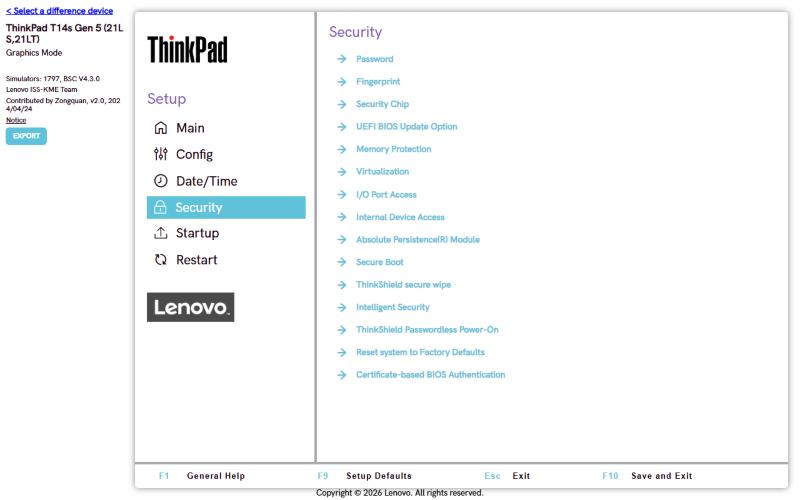

**Startup** — порядок загрузки, Boot Mode, меню F12, блокировка порядка.

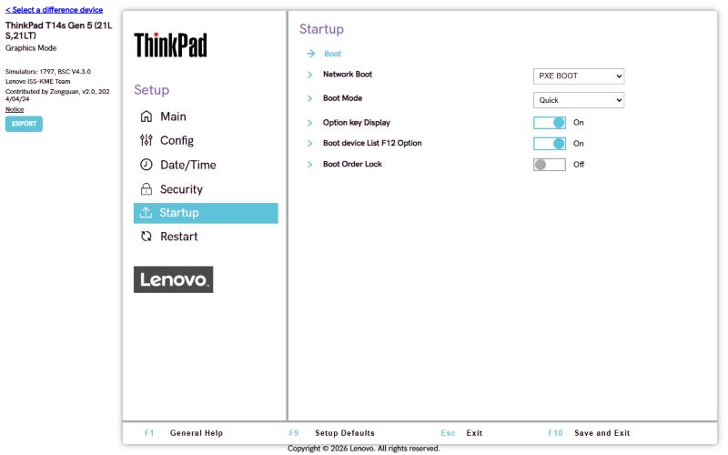

**Restart** — выход с сохранением или без, загрузка настроек по умолчанию.

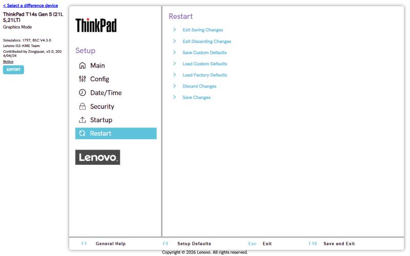

Где находятся настройки задач 2–5: порядок загрузки — **Startup**, Secure Boot и пароль — **Security**,
сброс настроек — **Restart** (или клавиша F9).

## Задача 2. Смена порядка загрузки

Путь: **Startup → Boot**. Исходный порядок: Windows Boot Manager, USB CD, USB FDD, NVMe0, USB HDD, PXE BOOT…

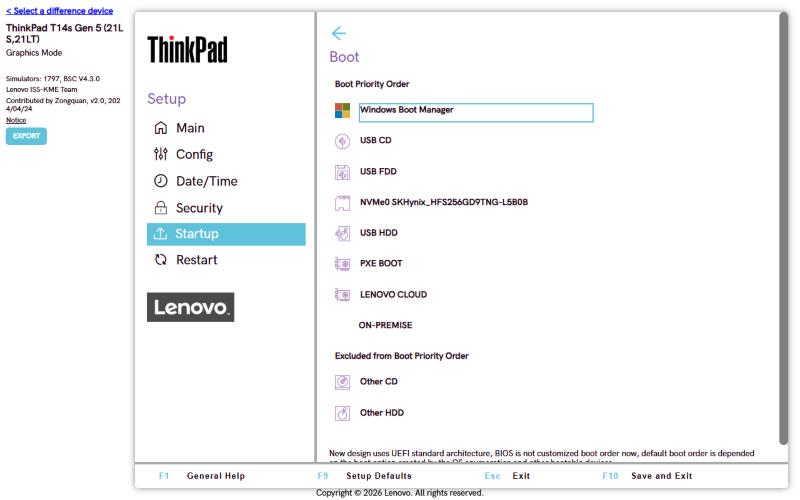

Перетащил **USB HDD** (флешку) на первое место:

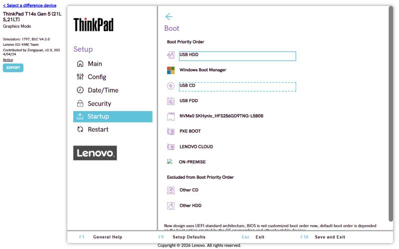

Перетащил **NVMe0** на второе место:

Нажал **F10** — окно «Save configuration changes and exit now?» → **Yes**:

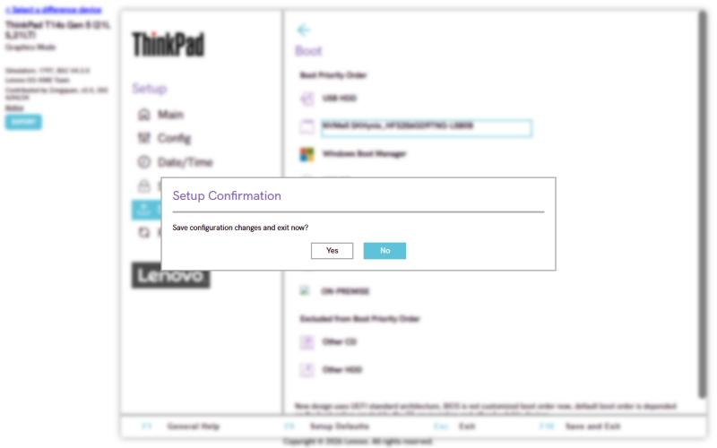

После сохранения порядок отображается там же, в Startup → Boot:

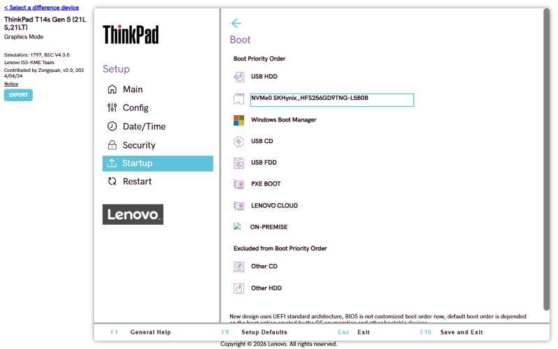

## Задача 3. Включение/выключение Secure Boot

Путь: **Security → Secure Boot → Secure Boot**. Исходно **On**, режим User Mode, ключи Standard Mode.

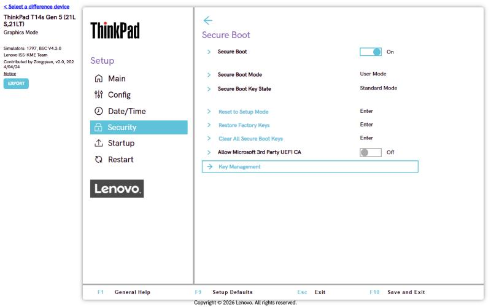

Переключил на **Off**:

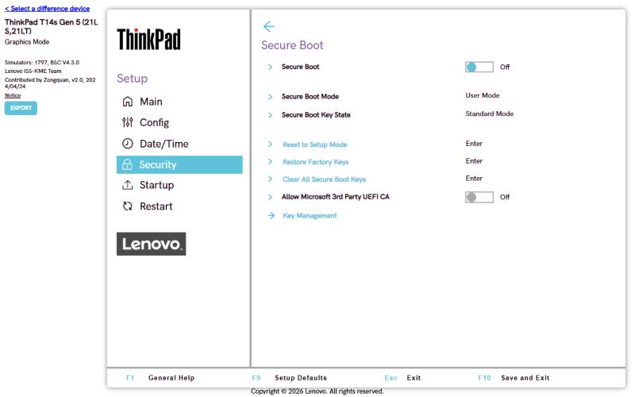

Вернул **On**:

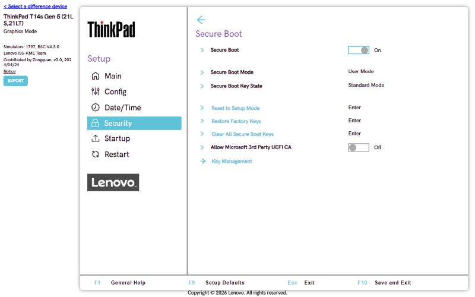

В симуляторе переключатель меняется сразу, без запроса. На реальном ноутбуке изменение вступает в силу
после сохранения (F10) и **перезагрузки**: Secure Boot проверяет загрузчик при старте.

**Зачем нужен Secure Boot:** UEFI запускает только загрузчики, подписанные доверенными ключами
(Microsoft, производитель). Это защищает от буткитов и руткитов, которые подменяют загрузчик до старта ОС.
Отключают его для неподписанных систем (некоторые Linux, старые LiveCD).

## Задача 4. Установка пароля супервизора

Путь: **Security → Password → Supervisor Password** (исходно Disabled). Открылось окно ввода:

Ввёл `Test1234` в оба поля:

После **Save** статус стал **Enabled**:

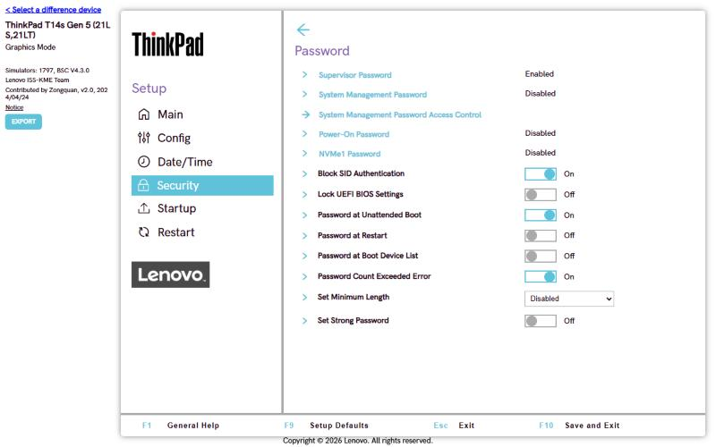

Проверка: при повторном открытии Supervisor Password симулятор показывает то же окно с паролем.
Отдельного запроса пароля при смене настроек симулятор не делает: на реальном ThinkPad пароль
спрашивается при входе в Setup.

Сброс: на реальном ноутбуке вводят текущий пароль, а новый оставляют пустым. В симуляторе кнопка Save
с пустыми полями не срабатывает:

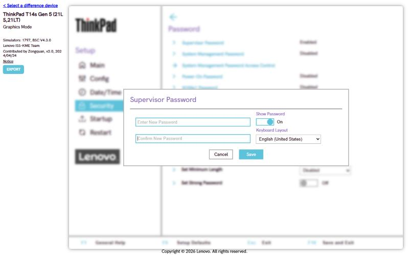

Поэтому пароль снял сбросом в задаче 5: после него статус снова **Disabled**.

## Задача 5. Сброс на заводские настройки

Путь: **Restart → Load Factory Defaults** → «Load the BIOS factory default configuration now?» → **Yes**.
Быстрая клавиша — **F9 (Setup Defaults)**.

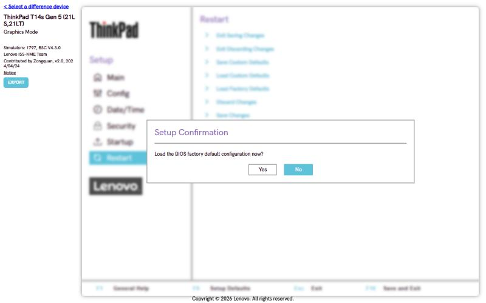

Порядок загрузки вернулся к исходному (Windows Boot Manager первым):

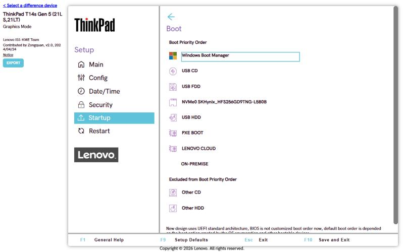

В симуляторе сбросился и пароль супервизора (Disabled):

На реальном ThinkPad пароль супервизора так **не** сбрасывается, его снимают вручную.
Не путать с **Security → Reset system to Factory Defaults**: это полный сброс устройства вместе с ключами и паролями.

## Задача 6. Управление встроенными устройствами

Путь: **Config → USB → Always On USB**. Исходно **On**:

Выключил — пропал зависимый пункт Charge in Battery Mode:

Включил обратно:

Always On USB подаёт питание на USB-порт, когда ноутбук выключен или спит (зарядка телефона).
Отдельного пункта USB BIOS Support на T14s Gen 5 нет. Сами порты отключаются в
**Security → I/O Port Access → USB Port**:

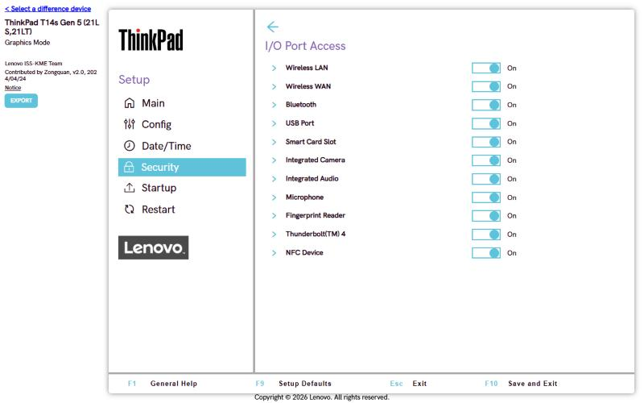

## Задача 7. Режим работы SATA/NVMe

На **T14s Gen 5** и **P15 Gen 2** раздела Storage в Config нет: стоит только NVMe-диск, режим не переключается.

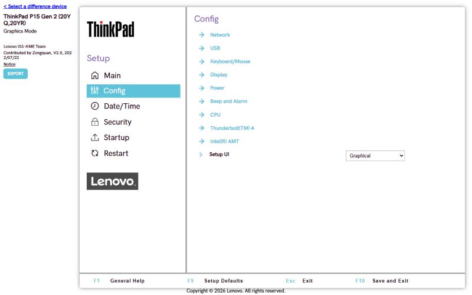

Поэтому открыл **ThinkPad T490**: там есть **Config → Storage**:

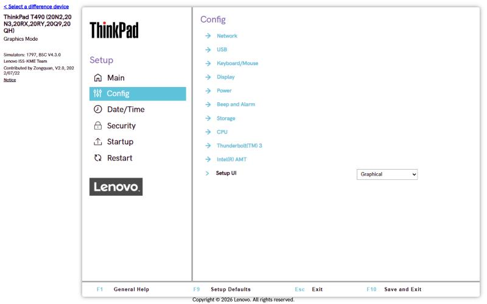

**Config → Storage → Controller Mode** = **AHCI mode**. Доступные варианты: AHCI mode и RST mode.

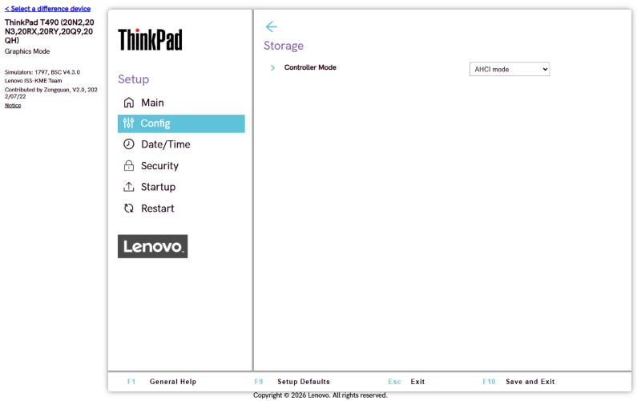

При выборе RST появилось предупреждение: *«The existing data stored on the drives may be damaged when changing Controller Mode»*:

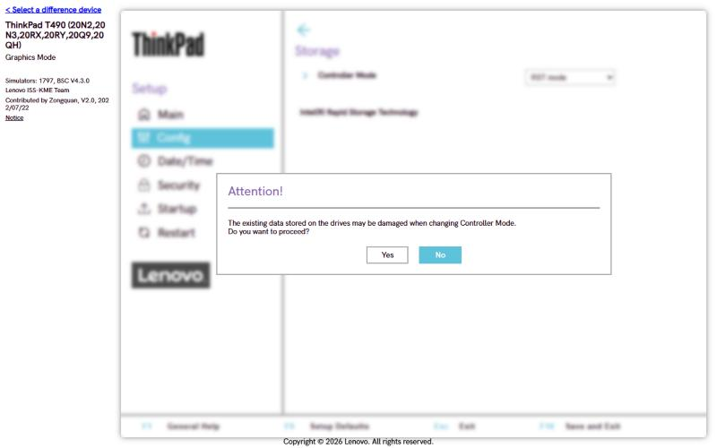

После подтверждения — **RST mode** (Intel Rapid Storage Technology):

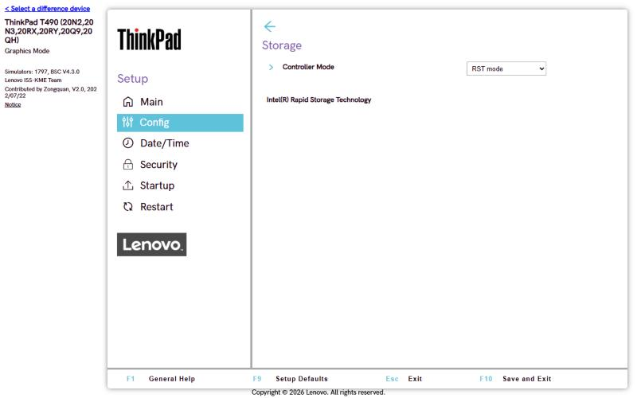

Вернул **AHCI mode**:

- **AHCI** — стандартный режим, драйвер есть в любой ОС.
- **RST (Intel Rapid Storage)** — RAID и кэширование через драйвер Intel.

**Риск:** если сменить режим после установки ОС, Windows не найдёт драйвер контроллера и упадёт
с ошибкой `INACCESSIBLE_BOOT_DEVICE`. Возможна и потеря данных, о чём предупреждает сам BIOS.
Режим выбирают **до** установки ОС.

## Задача 8. Временное меню загрузки (F12)

Путь: **Startup → Boot device List F12 Option**. Выключил:

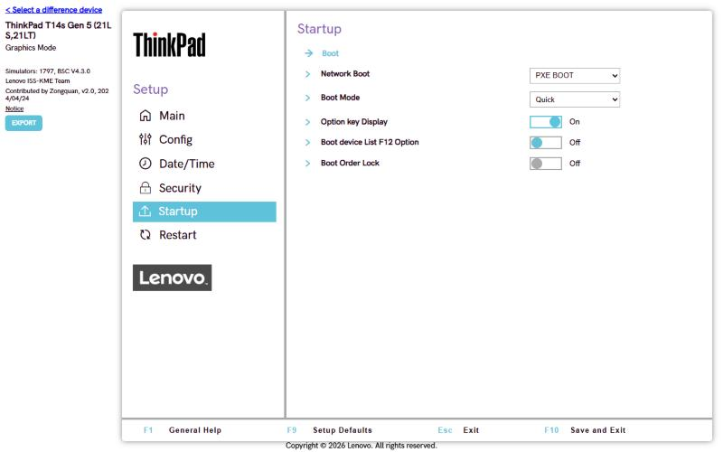

Включил обратно (**On**):

При включении ноутбука **F12** открывает список устройств, из которого загружаются **один раз**.
Постоянный порядок в Startup → Boot не меняется. Рядом: **Boot Mode** (Quick / Diagnostics) и
**Boot Order Lock** (запрет менять порядок загрузки).

## Задача 9. Просмотр системных логов

Путь: **Main → BIOS Event log**. В симуляторе пункт помечен «(Simulator not support)», журнал не открывается,
поэтому очистить его здесь нельзя:

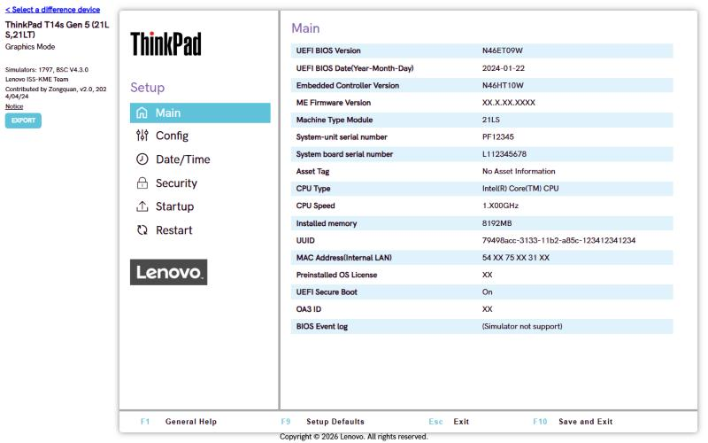

На реальном ThinkPad в этом журнале хранятся события POST, ошибки и изменения настроек, очищают его там же.

## Задача 10. Полный сценарий: подготовка к переустановке ОС

**1. Сброс на Factory Defaults** (Restart → Load Factory Defaults → Yes):

**2. Secure Boot = On:**

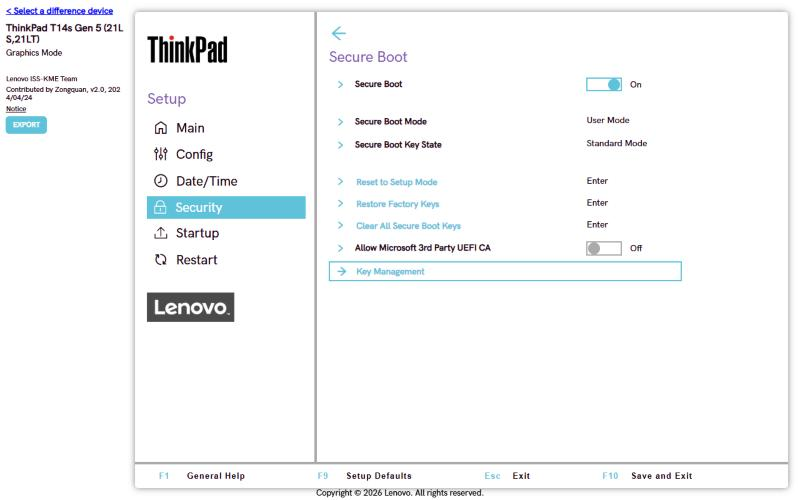

**3. Supervisor Password = `Test1234`**, статус Enabled:

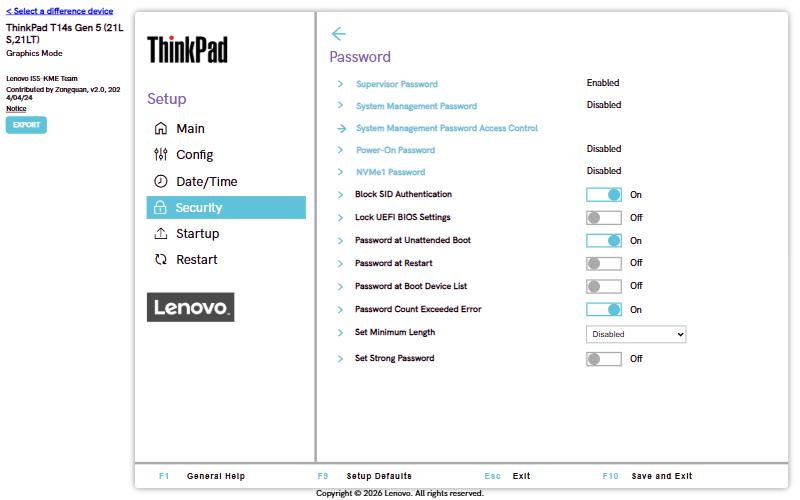

**4. USB HDD первым** в Startup → Boot:

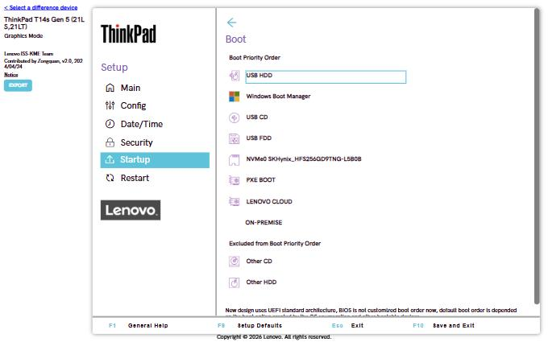

**5. Сохранить и выйти (F10 → Yes):**

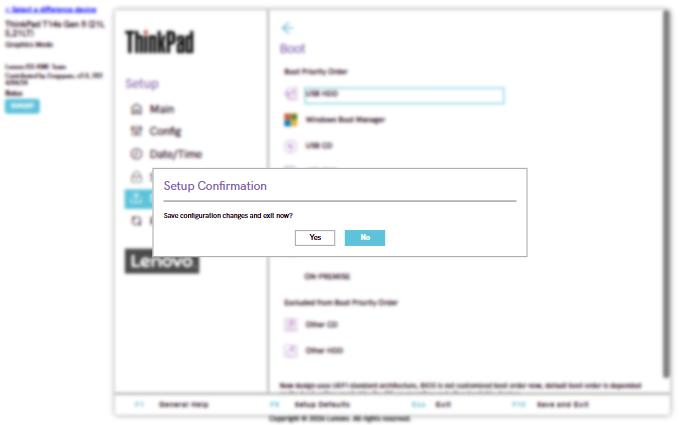

**6. Повторный вход и проверка:** порядок загрузки сохранился, пароль Enabled.

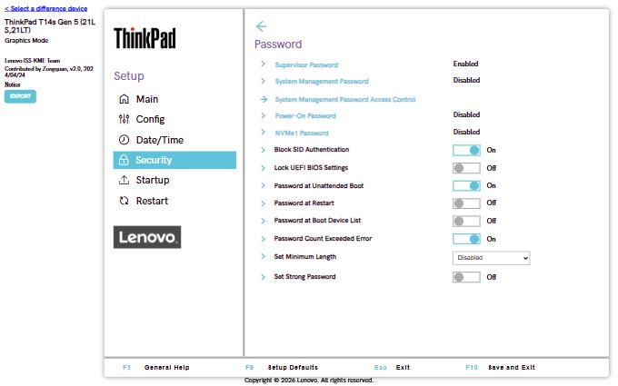

Затем снял пароль и вернул порядок загрузки сбросом (Restart → Load Factory Defaults):

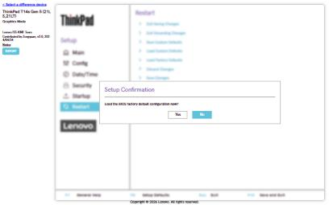

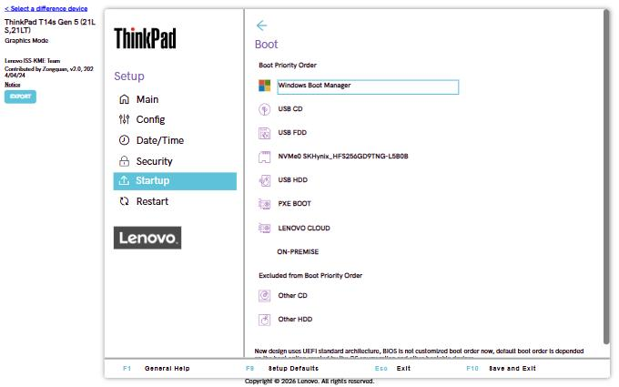

## Вывод

UEFI устроен одинаково на всех ThinkPad. В Main — информация, в Config — железо,
в Security — пароли и Secure Boot, в Startup — загрузка, в Restart — сохранение и сброс.
Главные клавиши — F9 (по умолчанию) и F10 (сохранить и выйти). Перед установкой ОС
проверяют порядок загрузки и Secure Boot, а режим накопителя после установки не меняют.

Отличия симулятора от реального ноутбука: нет запроса пароля при изменении настроек,
нельзя сохранить пустой пароль, Load Factory Defaults сбрасывает и пароль супервизора,
журнал событий не поддерживается.
